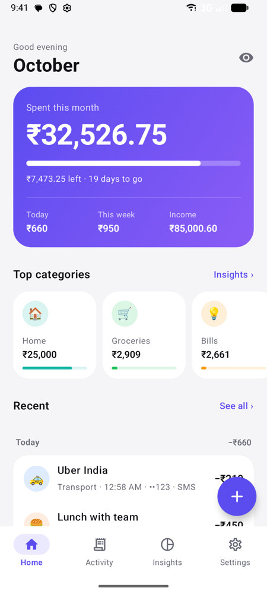
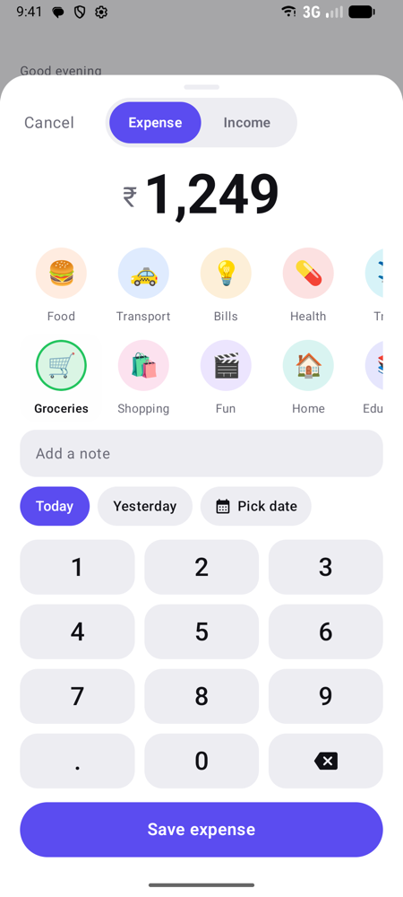
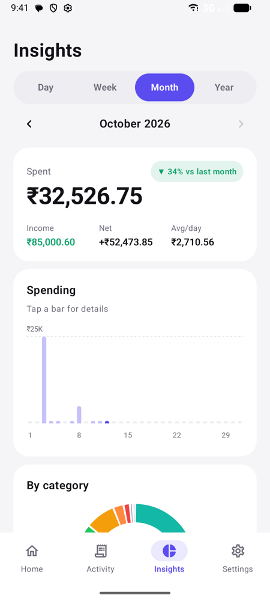
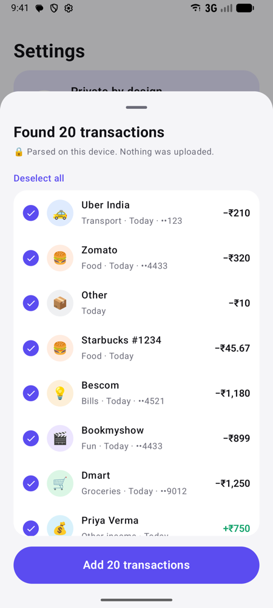
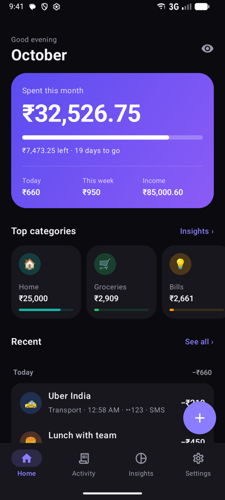
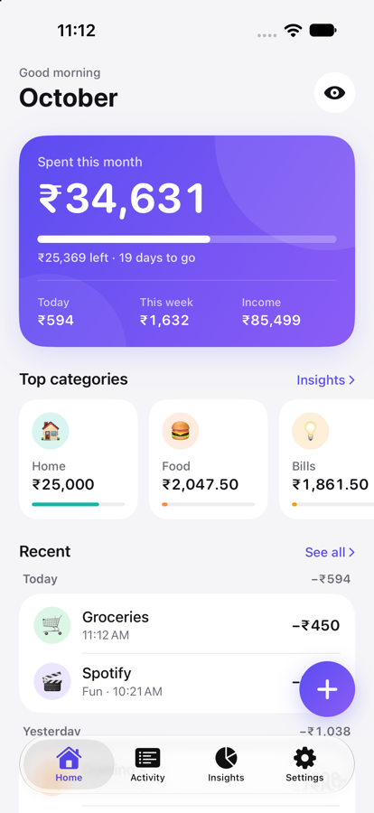
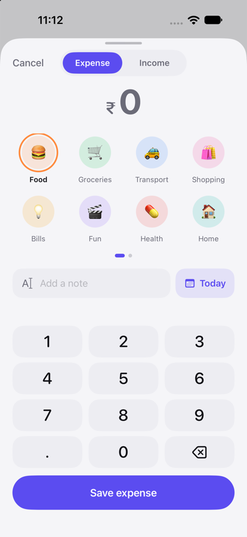
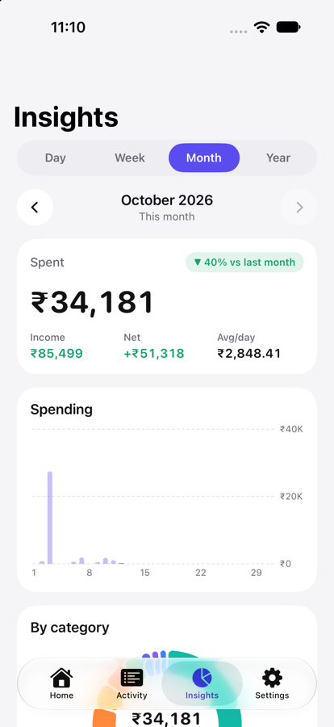
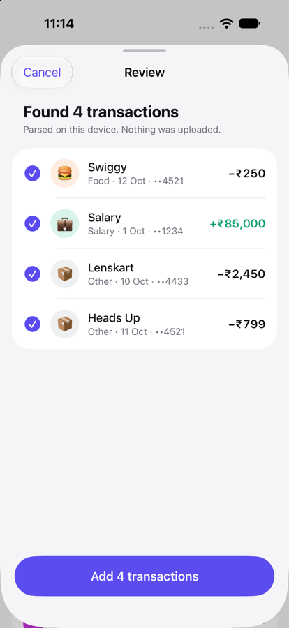
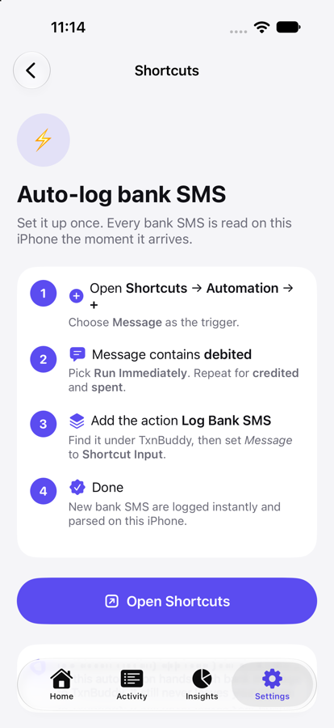

# TxnBuddy

A private expense tracker for **Android** and **iOS**. Add expenses in two taps, auto-capture bank SMS, and see daily, weekly, monthly and yearly insights by category. Nothing ever leaves the phone.

Two small native apps, SwiftUI and Jetpack Compose, built from one shared spec: [`DESIGN.md`](DESIGN.md). The Android release APK is **3.5 MB**, and the iOS app has zero dependencies.

<p>





</p>
<p>





</p>

## Privacy model

| | Android | iOS |
|---|---|---|
| Network | **No `INTERNET` permission**, so the OS blocks every connection | No networking code, no SDKs |
| Storage | One JSON file in app-private storage | One JSON file in the app sandbox (Data Protection) |
| Cloud backup | Disabled (`allowBackup=false`, extraction rules exclude all) | Excluded from iCloud/device backup |
| SMS | Read from inbox on-device; raw text is never stored, only amount/merchant/account plus a hash for dedupe | Same, via Shortcuts automation or paste |
| AI | Gemini Nano (ML Kit GenAI, AICore), on-device | Apple Foundation Models, on-device |
| Screens | `FLAG_SECURE` when App Lock is on | Privacy cover in the app switcher when App Lock is on |
| Accounts / analytics / ads | None | None |

ML Kit's AI library bundles Google's usage-telemetry pipeline. On Android it can never send anything, because the app has no INTERNET permission, and its upload backend is also removed from the manifest.

Backups are files *you* export (JSON). The format is the same on both platforms, so a backup made on Android restores on iOS and the other way round.

## How SMS capture works

* **Android:** grant SMS access. The first scan covers the last 180 days and opens a review list. After that, new bank SMS are added automatically each time you open the app (with Undo).
* **iOS:** Apple doesn't let *any* app read the SMS inbox. TxnBuddy instead ships a **"Log Bank SMS"** Shortcuts action. You create one Shortcuts automation once (*Message contains "debited" → Log Bank SMS*), and from then on each bank SMS is handed to the app, parsed on-device, and logged instantly. You can also paste a batch of messages to import history. Settings → *Auto-log with Shortcuts* has the step-by-step guide.

Parsing is a deterministic rule engine (amount, debit/credit, account last 4, merchant, date, category). It covers Indian bank, UPI and card formats plus common US formats, and is checked against [`shared/sms-samples.tsv`](shared/sms-samples.tsv) on both platforms. When the on-device model is available, it categorizes unknown merchants and rescues messages the rules can't read.

**Accounts.** Add your bank accounts, cards, wallets and cash in Settings → Accounts. Each SMS is matched to one by the last 4 digits of the card or account number (only those 4 digits are stored), or by a wallet name/ID. On Android, the sender name is used when a message has no number. When a new card or account shows up in your SMS, Home asks whether to create an account for it or add it to an existing one, and every past and future transaction from it follows. You can change any transaction's account in its edit sheet.

**Learns from you, on every phone.** When you pick or change a category, TxnBuddy remembers it for that merchant, and "Starbucks" also covers "Starbucks Coffee". Change one and it offers to fix the rest ("Apply to 6 more"). For merchants it hasn't seen, a small classifier trained only on your own past transactions makes a guess. Typing a note in the Add sheet picks the category the same way. It's a few hundred lines of code with no model to download, and what it learns stays in your data file (Settings → On-device AI → Learned from you shows the count and can forget it).

**On-device AI setup.** Settings → On-device AI shows why the model isn't available and what to do: turn on Apple Intelligence, wait for the download, update Android AICore, download Gemini Nano, or a note that the phone isn't supported. On Android, Gemini Nano for apps currently runs on Pixel 9 and newer, the Galaxy S26 series, Galaxy Z Fold7/Fold8/Flip8/TriFold, and some other recent flagships ([device list](https://developers.google.com/ml-kit/genai)).

## Project layout

```
DESIGN.md                 shared design system, screens, data model, SMS parser spec
shared/sms-samples.tsv    parser test vectors (both platforms must pass)
shared/icon.svg           master app icon
android/                  Kotlin + Jetpack Compose app
ios/                      SwiftUI app (project.yml + generated TxnBuddy.xcodeproj)
docs/screenshots/         Android emulator screenshots
```

## Build & run

### Android
Requires JDK 17+ and the Android SDK (API 36).
```bash
cd android
./gradlew testDebugUnitTest      # SMS parser vs shared test vectors
./gradlew assembleRelease        # minified APK, signed with the debug key for sideloading
adb install app/build/outputs/apk/release/app-release.apk
```

### iOS
Requires Xcode 26+ (for Apple Intelligence / Foundation Models; the app runs on iOS 17+ without AI).
```bash
open ios/TxnBuddy.xcodeproj      # set your Team under Signing, then Run
# or regenerate after editing project.yml:  cd ios && xcodegen
swiftc -O ios/TxnBuddy/SMSParser.swift ios/Tests/ParserCheck.swift -o /tmp/pc && /tmp/pc shared/sms-samples.tsv
```
Debug builds show **Settings → Load demo data** so you can explore the insights right away.

### CI and releases
[`.github/workflows/build.yml`](.github/workflows/build.yml) runs on every pull request and push to `main`:
* **Android:** unit tests (parser vectors + learning), a minified release build, and a check that the APK requests no network permission.
* **iOS:** the parser check and an unsigned Release build packaged as an `.ipa`.
* **On `main`:** both files are published as a GitHub release `v1.0.<run>`, with `versionCode` / build number set to the run number.

Android signing uses a stable release key when the repo secrets `TXNBUDDY_KEYSTORE_B64` (base64 of the `.jks`), `TXNBUDDY_KEYSTORE_PASSWORD`, `TXNBUDDY_KEY_ALIAS` and `TXNBUDDY_KEY_PASSWORD` are set. Without them, each build gets a throwaway debug key and won't install over the previous one. The iOS file is unsigned: sign it with your Apple ID using a sideloading tool, or build from Xcode.

## Verification status

* **Android:** parser tests pass (26 vectors). Debug and release builds succeed, and the release APK's permissions are only `READ_SMS`, `USE_BIOMETRIC` and AICore bind. Tested end to end on an API 36 emulator: real injected SMS → review → import, auto-import with Undo, add/edit/delete, insights, app lock (PIN), backup → erase → restore, dark mode. Gemini Nano and fingerprint unlock still need a real phone (Pixel 9+ / Galaxy S25 class for Nano).
* **iOS:** parser check passes (26 vectors). Built with Xcode 27 for device and simulator with zero warnings, and the static analyzer is clean. The release app is 3.9 MB, and the "Log Bank SMS" Shortcuts action is registered in the app's metadata. Tested in the iOS 27 simulator (iPhone 18 Pro): onboarding, add expense via keypad, all Insights periods, paste → SMS review → import, Shortcuts guide, dark mode, and Face ID App Lock (enable, relaunch locked, unlock). The data folder is confirmed excluded from backups and stores no SMS text. Running the Shortcuts automation on a real Message, and Foundation Models output (the dev Mac's Apple Intelligence model wasn't downloaded, so the app correctly fell back to rule-based categories), still need a device.
